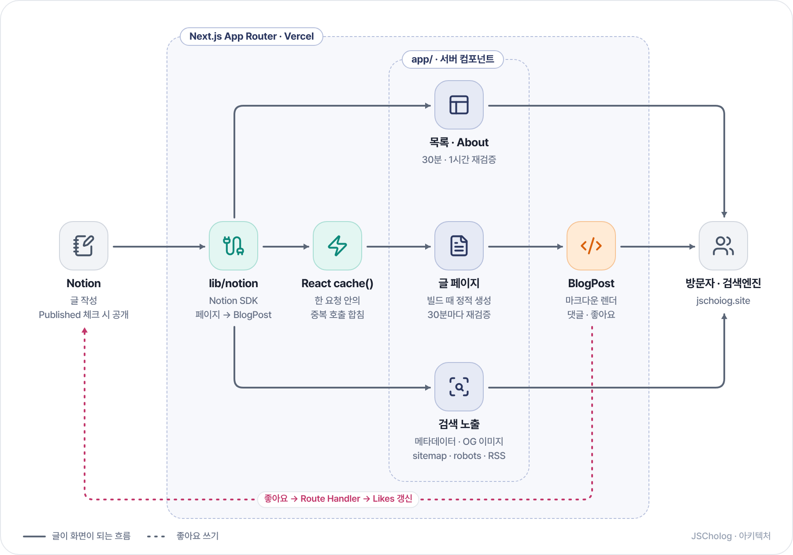

# JSChoilog

## 아키텍처

- **글은 Notion에서 쓰고 화면은 Next.js가 그린다**: Notion 데이터베이스에서 Published를 체크한 글만 `lib/notion`이 읽어 옵니다. 글을 올릴 때 커밋이나 배포가 필요 없습니다.
- **정적 생성과 30분 재검증**: 글 페이지는 빌드 때 미리 만들고 30분마다 다시 만듭니다. Notion 커버 이미지 URL이 약 1시간 뒤 만료돼서 그보다 짧게 잡았습니다.
- **한 요청 안의 중복 호출 합치기**: 레이아웃·메타데이터·페이지가 같은 글을 각각 요청하므로, `resolve.ts`의 React `cache()`로 Notion을 한 번만 호출합니다.
- **검색 노출**: 글마다 메타데이터·canonical·OG 이미지를 만들고 sitemap·robots·RSS를 제공합니다.
- **좋아요**: 클라이언트 컴포넌트가 Route Handler(`/api/posts/[id]/like`)를 호출해 Notion의 Likes 값을 올립니다.

## 컨벤션

- **Git Commit 컨벤션 (Conventional Commit)**
  - Feat: 새로운 기능 추가
  - Fix: 버그 수정
  - Desing: CSS 등 사용자 UI 디자인 변경
  - Docs: 문서 수정
  - style: 코드 포맷팅 (비즈니스 로직 변경 없음)
  - Refactor: 리팩토링
  - Comment: 주석 추가 또는 변경
  - Chore: 빌드/패키지 관리 변경
  - Rename: 파일 또는 폴더 이름 수정/이동만 수행한 경우
  - Remove: 파일 또는 폴더 삭제만 수행한 경우
